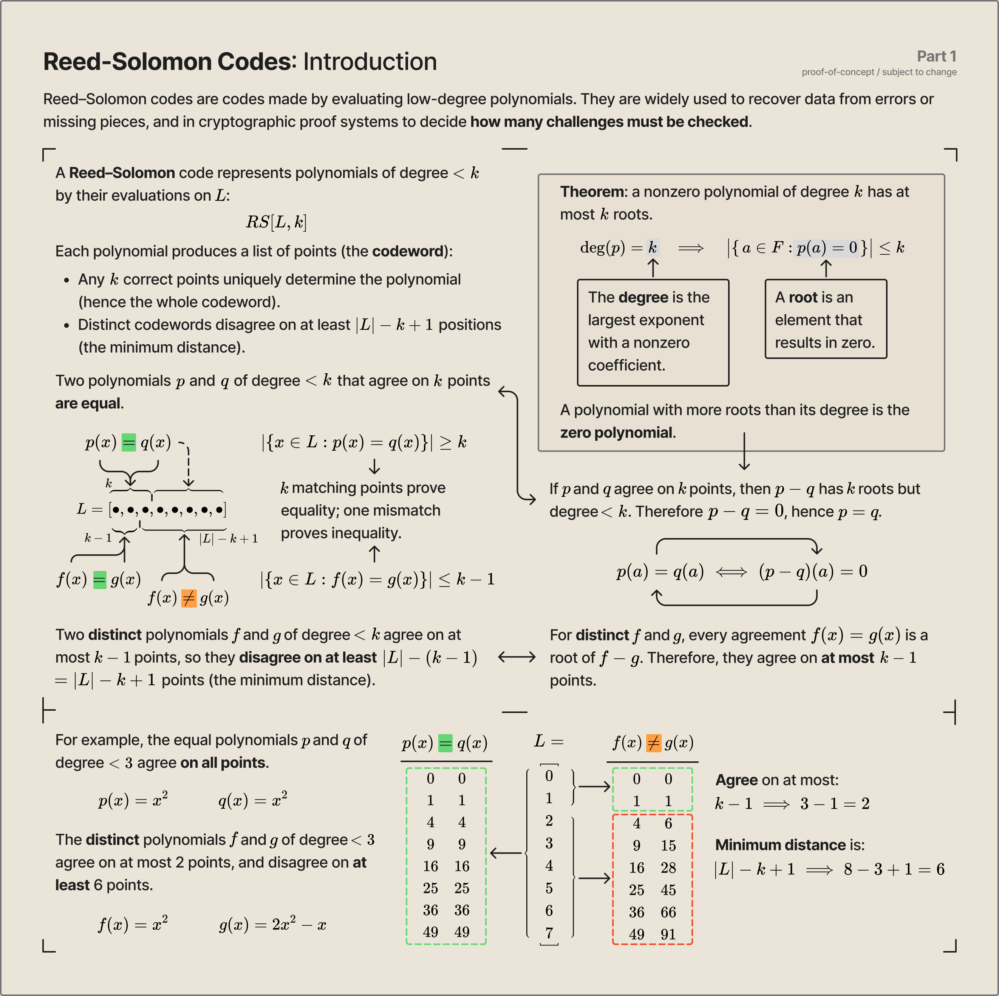
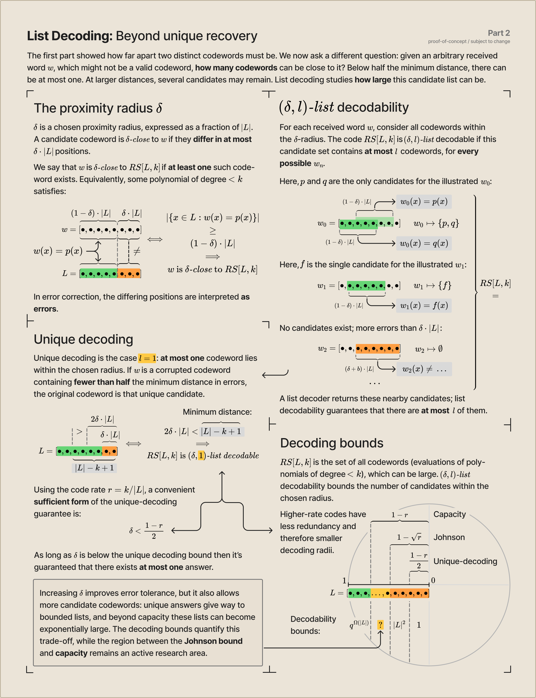

# RS Proximity Research

A personal study of Reed–Solomon codes, list decoding, proximity gaps, and correlated agreement, with an eye toward their role in FRI-based proof systems. The repository contains exploratory Lean 4/Mathlib formalizations, reference papers, and visual notes.

This study is based on [*Proximity Gaps for Reed–Solomon Codes*](assets/Proximity-Gaps-for-RS-Codes.pdf) by Ben-Sasson et al. and [*On Reed–Solomon Proximity Gaps Conjectures*](assets/On-RS-Proximity-Gaps-Conjectures.pdf) by Crites and Stewart, both included in `assets/`.

> **Very much a work in progress.** The mathematics, Lean development, and charts are incomplete and subject to change; some theorems are currently stated with `sorry`.

## Reed–Solomon codes

Reed–Solomon codes represent low-degree polynomials by their evaluations on a domain. A simple root-counting argument bounds how many positions two distinct codewords can share, giving the distance guarantees used in error correction and proximity testing.

## List decoding

List decoding asks how many codewords lie within a chosen proximity radius of an arbitrary received word. Below half the minimum distance there is at most one candidate; beyond that radius, the Johnson and capacity bounds describe the trade-off between error tolerance and candidate-list size.

